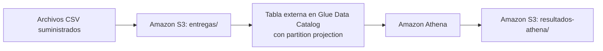

# Examen final de ingeniería de datos

Este repositorio contiene dos puntos independientes:

| Punto | Tema | Ubicación |
| --- | --- | --- |
| 1 | Entregas en S3 consultadas con Athena y partition projection (Terraform, Glue, Athena) | Raíz del repositorio (este README) |
| 2 | Ventas diarias con control de actualidad (dbt, DuckDB, Airflow) | [examen-ventas/](examen-ventas/README.md) |

El punto 1 se mantiene en la raíz porque su enunciado pide rutas relativas a la raíz del
repositorio (por ejemplo, en `evidencias/ejecuciones_athena.csv`).

---

# Punto 1: entregas en S3 consultadas con Athena y partition projection

Una empresa de mensajería recibe un CSV por día con los intentos de entrega. Los archivos
quedan en S3, Glue Data Catalog guarda el esquema de la tabla y las reglas de partition
projection, y Athena consulta los datos y escribe los resultados en otro prefijo del bucket.
Así, una fecha nueva solo requiere subir su archivo: no hay crawlers ni particiones registradas.



El enunciado completo está en [ENUNCIADO.md](ENUNCIADO.md).

## Prerrequisitos

- Cuenta de AWS con permisos sobre S3, Glue Data Catalog y Athena.
- Terraform 1.5 o superior (se usó la versión 1.16.6).
- AWS CLI v2, con las credenciales configuradas mediante `aws configure`.
- Región: `us-east-1`.
- Terminal Linux (se usó Ubuntu en WSL 2) y `git`.

Comprobar el entorno antes de empezar:

```bash
terraform version
aws --version
aws sts get-caller-identity
```

## Estructura del repositorio

```text
├── README.md                 # Este documento: pasos reproducibles
├── ENUNCIADO.md              # Enunciado del ejercicio
├── .gitignore                # Excluye credenciales, estado de Terraform y .terraform/
├── data/entregas/            # CSV de entrada suministrados (no se modifican)
├── resultados_esperados/     # Referencias suministradas para comparar
├── infraestructura/          # Terraform: principal.tf, variables.tf, salidas.tf
├── consultas/                # SQL ejecutado en Athena
├── resultados/inicial/       # Resultados de Athena con los días 1 y 2
├── resultados/final/         # Resultados de Athena con los tres días
├── evidencias/               # Salidas de Terraform y registro de ejecuciones de Athena
└── respuestas.md             # Respuestas a las preguntas conceptuales
```

## 1. Despliegue de la infraestructura

Toda la infraestructura está en `infraestructura/` y se crea con Terraform:

| Archivo | Contenido |
| --- | --- |
| `principal.tf` | Proveedor AWS, bucket privado (bloqueo de acceso público, ACL deshabilitadas y cifrado SSE-S3), base de datos de Glue, tabla externa con partition projection y workgroup de Athena. |
| `variables.tf` | Región, nombre del bucket, prefijos, nombres de base, tabla y workgroup, y rango de la proyección. |
| `salidas.tf` | Bucket, ubicaciones de datos y resultados, base de datos, tabla, rango proyectado y workgroup. |

### Configuración

Valores por defecto (se pueden cambiar con `-var nombre=valor`):

| Variable | Valor |
| --- | --- |
| `region` | `us-east-1` |
| `nombre_bucket` | `de-final-entregas-gr01-user-6` (debe ser único en todo AWS) |
| `prefijo_datos` | `entregas/` |
| `prefijo_resultados` | `resultados-athena/` |
| `nombre_base_datos` | `entregas_db` |
| `nombre_tabla` | `entregas` |
| `nombre_workgroup` | `entregas-wg` |
| `fecha_inicio_proyeccion` / `fecha_fin_proyeccion` | `2026-10-01` / `2026-10-03` |

### Tabla `entregas_db.entregas`

- Columnas, en el orden del CSV: `id_envio string`, `ciudad string`, `transportadora string`,
  `estado string`, `duracion_minutos int`.
- Lectura: `LazySimpleSerDe` con `field.delim = ","` y `skip.header.line.count = 1` para omitir
  el encabezado de cada archivo.
- Clave de partición `fecha string`, que no es columna del archivo: sale de la carpeta `fecha=yyyy-MM-dd`.
- Partition projection:

| Propiedad | Valor |
| --- | --- |
| `projection.enabled` | `true` |
| `projection.fecha.type` | `date` |
| `projection.fecha.format` | `yyyy-MM-dd` |
| `projection.fecha.range` | `2026-10-01,2026-10-03` (ambos incluidos) |
| `projection.fecha.interval` / `interval.unit` | `1` / `DAYS` |
| `storage.location.template` | `s3://<bucket>/entregas/fecha=${fecha}/` |

En Terraform la plantilla se escribe `$${fecha}` para que quede el texto literal `${fecha}`,
que Athena reemplaza por cada fecha proyectada. No se crea ninguna partición individual.

### Pasos

```bash
cd infraestructura
terraform init
terraform fmt -check
terraform validate
terraform plan
terraform apply 2>&1 | tee ../evidencias/aplicacion_terraform.txt
terraform output -json > ../evidencias/outputs.json
cd ..
```

`terraform apply` pide confirmación (`yes`). El plan crea 7 recursos: el bucket, su bloqueo de
acceso público, sus controles de propiedad, su cifrado, la base de datos, la tabla y el workgroup.

## 2. Carga inicial: días 1 y 2

Se suben solo los días 1 y 2, cada archivo con su propio comando (sin `--recursive`).
El día 3 se conserva localmente hasta la segunda etapa.

```bash
BUCKET=de-final-entregas-gr01-user-6
aws s3 cp "data/entregas/fecha=2026-10-01/entregas.csv" "s3://$BUCKET/entregas/fecha=2026-10-01/entregas.csv"
aws s3 cp "data/entregas/fecha=2026-10-02/entregas.csv" "s3://$BUCKET/entregas/fecha=2026-10-02/entregas.csv"
aws s3 ls "s3://$BUCKET/entregas/" --recursive
```

Comprobación en Athena: `SELECT count(*) FROM entregas_db.entregas` devuelve **12** registros
(6 por día; el encabezado no se cuenta).

## 3. Consultas de la etapa inicial

En la consola de Athena (`us-east-1`): **Workgroup `entregas-wg`**, catálogo `AwsDataCatalog`
y base de datos `entregas_db`. Para cada consulta se pega el contenido del `.sql`, se ejecuta,
se anota el ID de la ejecución y se descarga el CSV de resultados con **Descargar resultados
en formato CSV**. También se puede ejecutar desde el CLI:

```bash
aws athena start-query-execution --work-group entregas-wg \
  --query-execution-context Database=entregas_db \
  --query-string "$(cat consultas/intentos_por_fecha_estado.sql)"
```

y descargar el resultado de `s3://<bucket>/resultados-athena/<id_ejecucion>.csv`.

| Consulta | Resultado | Referencia |
| --- | --- | --- |
| `consultas/intentos_por_fecha_estado.sql` | `resultados/inicial/intentos_por_fecha_estado.csv` | `resultados_esperados/intentos_por_fecha_estado_inicial.csv` |
| `consultas/porcentaje_exito_por_fecha_ciudad.sql` | `resultados/inicial/porcentaje_exito_por_fecha_ciudad.csv` | `resultados_esperados/porcentaje_exito_por_fecha_ciudad_inicial.csv` |
| `consultas/duracion_promedio_2026-10-02.sql` | `resultados/inicial/duracion_promedio_2026-10-02.csv` | `resultados_esperados/duracion_promedio_2026-10-02.csv` |

Los CSV se guardan tal como los entrega Athena, con cada valor entre comillas. Sin las comillas,
coinciden exactamente con las referencias:

```bash
diff <(tr -d '"' < resultados/inicial/intentos_por_fecha_estado.csv) \
     resultados_esperados/intentos_por_fecha_estado_inicial.csv
```

Decisiones del SQL:

- El porcentaje convierte el conteo de éxitos a `double` antes de dividir, para evitar la
  división entera; el denominador `count(*)` incluye los tres estados.
- Porcentaje y promedio se redondean con `round(…, 2)` y se convierten a `decimal`, para
  conservar siempre dos decimales.
- El promedio filtra `estado = 'entregado'`: los fallidos tienen duración 0 y no deben contarse.
- La consulta de intentos no filtra fechas, así que en la etapa final se ejecuta sin cambios.

Cada ejecución queda registrada en `evidencias/ejecuciones_athena.csv`
(`etapa,archivo_sql,id_ejecucion,archivo_resultado`) con la etapa `inicial`.

## 4. Incorporación del día 3

La nueva fecha solo requiere **subir el archivo y consultar**. No se modifica Terraform ni
ninguna propiedad de la tabla, y no se usan crawlers, `MSCK REPAIR TABLE` ni
`ALTER TABLE ADD PARTITION`: el rango proyectado ya incluía `2026-10-03` desde el despliegue.

```bash
aws s3 cp "data/entregas/fecha=2026-10-03/entregas.csv" \
  "s3://de-final-entregas-gr01-user-6/entregas/fecha=2026-10-03/entregas.csv"
```

Comprobación de que Glue no tiene particiones registradas (devuelve `0` antes y después de
cargar el día 3):

```bash
aws glue get-partitions --database-name entregas_db --table-name entregas --query "length(Partitions)"
```

`consultas/verificacion_tercer_dia.sql` contiene tres consultas que se ejecutan por separado
en el workgroup `entregas-wg`:

| Consulta | Resultado | Valor obtenido |
| --- | --- | --- |
| Registros del 2026-10-03 | `resultados/final/verificacion_tercer_dia.csv` | 6 registros, `ENV-013` a `ENV-018` |
| Conteos por estado del 2026-10-03 | `resultados/final/verificacion_tercer_dia_conteo_estados.csv` | `destinatario_ausente` 3, `direccion_incorrecta` 1, `entregado` 2 |
| Total de la tabla | `resultados/final/verificacion_total_registros.csv` | 18 registros en 3 fechas |

Después se ejecutan de nuevo, sin cambios, las dos consultas agregadas (no tienen filtro de
fechas, así que incluyen el día 3):

| Consulta | Resultado | Referencia |
| --- | --- | --- |
| `consultas/intentos_por_fecha_estado.sql` | `resultados/final/intentos_por_fecha_estado.csv` | `resultados_esperados/intentos_por_fecha_estado_final.csv` |
| `consultas/porcentaje_exito_por_fecha_ciudad.sql` | `resultados/final/porcentaje_exito_por_fecha_ciudad.csv` | `resultados_esperados/porcentaje_exito_por_fecha_ciudad_final.csv` |

Ambos coinciden con sus referencias (sin las comillas de Athena), y los conteos por estado del
día 3 coinciden con sus filas en `intentos_por_fecha_estado_final.csv`. Las cinco ejecuciones
quedan en `evidencias/ejecuciones_athena.csv` con la etapa `final`. El promedio de duración
sigue correspondiendo al día 2 y no se vuelve a ejecutar.

## 5. Limpieza

Primero se guardan y se versionan todas las evidencias (resultados, ejecuciones y salidas de
Terraform). Después se vacía el bucket, que contiene los CSV de `entregas/` y los resultados de
Athena en `resultados-athena/`; Terraform no elimina un bucket con objetos.

```bash
aws s3 rm s3://de-final-entregas-gr01-user-6 --recursive
aws s3 ls s3://de-final-entregas-gr01-user-6 --recursive   # no debe listar nada
```

Luego se eliminan con Terraform los siete recursos del ejercicio (bucket y sus tres
configuraciones, base de datos, tabla y workgroup):

```bash
cd infraestructura
terraform destroy -no-color 2>&1 | tee ../evidencias/eliminacion_terraform.txt
cd ..
```

El resultado fue `Destroy complete! Resources: 7 destroyed.`
(`evidencias/eliminacion_terraform.txt`). Para comprobar que no queda nada:

```bash
aws s3api head-bucket --bucket de-final-entregas-gr01-user-6          # 404 Not Found
aws glue get-database --name entregas_db                               # EntityNotFoundException
aws athena get-work-group --work-group entregas-wg                     # no existe
terraform -chdir=infraestructura state list                            # vacío
```

El archivo de estado de Terraform y la carpeta `.terraform/` quedan solo en el equipo local:
están excluidos por `.gitignore` y no forman parte de la entrega.
