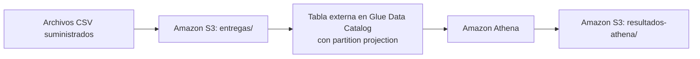

# Entregas en S3 consultadas con Athena y partition projection

Una empresa de mensajería recibe un CSV por día con los intentos de entrega. Los archivos
quedan en S3, Glue Data Catalog guarda el esquema de la tabla y las reglas de partition
projection, y Athena consulta los datos y escribe los resultados en otro prefijo del bucket.
Así, una fecha nueva solo requiere subir su archivo: no hay crawlers ni particiones registradas.



El enunciado completo está en [ENUNCIADO.md](ENUNCIADO.md).

## Prerrequisitos

- Cuenta de AWS con permisos sobre S3, Glue Data Catalog y Athena.
- Terraform 1.5 o superior (se usó la versión 1.16.6).
- AWS CLI v2, con las credenciales configuradas mediante `aws configure`.
- Región: `us-east-1`.
- Terminal Linux (se usó Ubuntu en WSL 2) y `git`.

Comprobar el entorno antes de empezar:

```bash
terraform version
aws --version
aws sts get-caller-identity
```

## Estructura del repositorio

```text
├── README.md                 # Este documento: pasos reproducibles
├── ENUNCIADO.md              # Enunciado del ejercicio
├── .gitignore                # Excluye credenciales, estado de Terraform y .terraform/
├── data/entregas/            # CSV de entrada suministrados (no se modifican)
├── resultados_esperados/     # Referencias suministradas para comparar
├── infraestructura/          # Terraform: principal.tf, variables.tf, salidas.tf
├── consultas/                # SQL ejecutado en Athena
├── resultados/inicial/       # Resultados de Athena con los días 1 y 2
├── resultados/final/         # Resultados de Athena con los tres días
├── evidencias/               # Salidas de Terraform y registro de ejecuciones de Athena
└── respuestas.md             # Respuestas a las preguntas conceptuales
```

## 1. Despliegue de la infraestructura

_Pendiente: se documenta al desarrollar `infraestructura/`._

## 2. Carga inicial: días 1 y 2

_Pendiente._

## 3. Consultas de la etapa inicial

_Pendiente._

## 4. Incorporación del día 3

_Pendiente._

## 5. Limpieza

_Pendiente._
