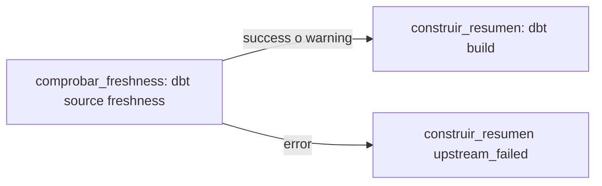

# Punto 2: ventas diarias con control de actualidad (dbt + Airflow)

Este punto completa un resumen diario de ventas con dbt sobre DuckDB y evita que Airflow lo
reconstruya cuando la fuente está desactualizada. El enunciado completo está en
[ENUNCIADO.md](ENUNCIADO.md). El punto 1 (Athena y partition projection) está en la
[raíz del repositorio](../README.md).



## Archivos modificados

Solo se modificaron los tres archivos permitidos:

| Archivo | Cambio |
| --- | --- |
| `dbt/models/ventas_diarias.sql` | Una fila por `fecha_venta` con `numero_ventas`, `unidades_vendidas` e `ingreso_total` (suma de `cantidad * precio_unitario`, en `DECIMAL`). |
| `dbt/models/sources.yml` | Freshness de `raw.ventas` con `loaded_at_field: _loaded_at`: advertencia después de 12 h y error después de 24 h. |
| `airflow/dags/examen_ventas.py` | Tarea `comprobar_freshness` que reutiliza `run_dbt` con `["source", "freshness"]` y se ejecuta antes de `construir_resumen` (regla `all_success`). |

## Entorno

Entorno oficial con Docker (imagen `smendezm/examen-ventas:1.0`), desde esta carpeta:

```bash
bash scripts/preparar.sh
docker compose pull
docker compose up -d --wait airflow
bash scripts/examen.sh check
```

En WSL con usuario `root`, `preparar.sh` se niega a ejecutarse. En ese caso se crea el mismo
`.env` a mano con un UID no root, el del usuario `airflow` de la imagen:
`(umask 077; printf 'AIRFLOW_UID=50000\n' > .env)`. El `.env` no se versiona.

Airflow queda en http://localhost:8080 (usuario `estudiante`, contraseña `examen-local`).

## Resultado del modelo

`bash scripts/examen.sh dbt build` termina con `PASS=19 WARN=0 ERROR=0` y el resumen es:

| fecha_venta | numero_ventas | unidades_vendidas | ingreso_total |
|---|---:|---:|---:|
| 2026-01-10 | 2 | 3 | 46.00 |
| 2026-01-11 | 3 | 6 | 51.25 |
| 2026-01-12 | 1 | 4 | 12.40 |

## Demostración

| Escenario | Ejecución de Airflow | comprobar_freshness | construir_resumen |
| --- | --- | --- | --- |
| actualizada (≈ 2 h) | `manual__2026-11-12T12:18:36.961068+00:00` | `success` | `success` |
| desactualizada (≈ 30 h) | `manual__2026-11-12T12:20:31.932608+00:00` | `failed` | `upstream_failed` |

Pasos seguidos: `bash scripts/examen.sh scenario actualizada`, Trigger DAG, consulta del
resumen; luego `bash scripts/examen.sh scenario desactualizada`, Trigger DAG (ejecución nueva),
consulta del resumen. Entre la preparación del escenario desactualizado y las evidencias no se
ejecutó ningún build manual.

## Evidencias

| Archivo | Contenido |
| --- | --- |
| `evidencias/capturas/1_actualizada_run_success.png` | Ejecución actualizada con su Run ID y ambas tareas en `success`. |
| `evidencias/capturas/2_desactualizada_run_failed.png` | Ejecución desactualizada: freshness `failed`, build `upstream_failed`. |
| `evidencias/capturas/3_desactualizada_log_freshness.png` | Log de Airflow de `comprobar_freshness` en la ejecución desactualizada. |
| `evidencias/desactualizada_log_freshness.txt` | Log completo de la tarea, más la salida de dbt con `ERROR STALE freshness of ventas_raw.ventas`. |
| `evidencias/desactualizada_sources.json` | Artefacto de freshness: `status: error`, 30,01 h desde la última carga, umbrales de 12 h y 24 h. |
| `evidencias/estados_airflow.txt` | Estados de todas las ejecuciones; build sin intento ni `INICIO dbt` en la desactualizada. |
| `evidencias/resumen_antes_bloqueo.txt` | Resumen consultado después de la ejecución actualizada. |
| `evidencias/resumen_despues_bloqueo.txt` | Resumen consultado después del bloqueo: idéntico al anterior. |

`run_dbt` no redirige la salida de dbt al log de la tarea, por eso el log de Airflow solo
muestra `returned non-zero exit status 1`. El motivo (`ERROR STALE`, 30,01 h) se tomó de la
salida del contenedor, de `dbt.log` y del artefacto `sources.json` de esa misma ejecución.

Las dos primeras ejecuciones del DAG (12:10 y 12:12) fueron un primer intento de la misma
demostración; se repitió para guardar el resumen antes del bloqueo en el orden correcto.

## Respuestas

Las respuestas a las preguntas conceptuales están en [respuestas.md](respuestas.md).

## Detener

```bash
docker compose stop
```

No usar `docker compose down -v`: borra los volúmenes con el resumen y el estado de Airflow.
